# Vellmare: 3D Hotel Experience

Interactive real-time promotion of a fictional coastal development, with its own Blender pipeline.

Visitors fly over the site, change the time of day, check availability, walk through interiors and open property sheets. Architecture, vegetation and interiors are generated by a scripted Blender pipeline.

> **Structure only.** The source code is private. Source files here are intentionally empty so you can see how the project is organized. Commands describe the private codebase.

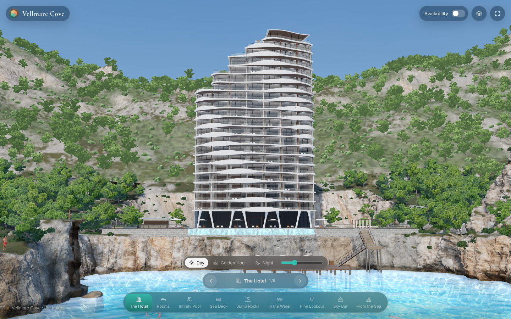

## Features

- Aerial tour with nine viewpoints
- Day, golden hour and night
- Availability overlay and unit cards
- Interior walkthroughs
- Property sheets, floor plans and map
- Animated guests and instanced vegetation

## Architecture

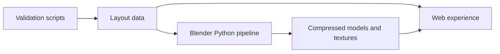

## Engineering highlights

- Same terrain function in TypeScript and Python, checked for parity
- Impostor atlases for thousands of plants
- Draco compressed models
- Spatial validation scripts
- Procedural fallback for every missing asset

## Screenshots

| Running application | Cove |
| --- | --- |
|  | 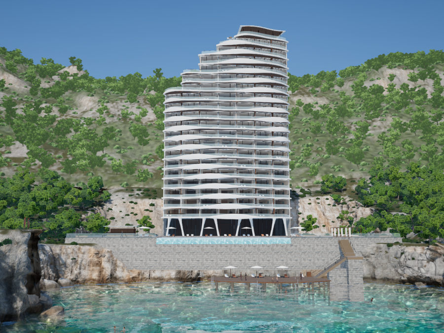 |
| **From the sea** | **Sea deck** |
| 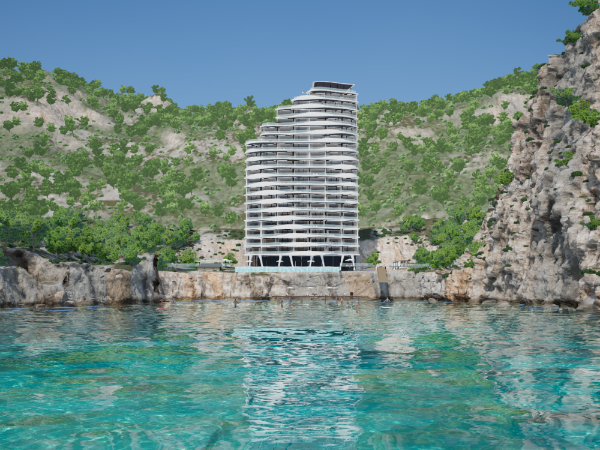 | 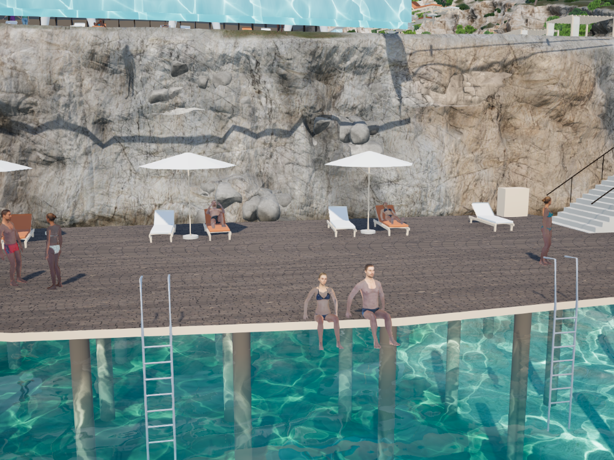 |
| **Jump rocks** | **Room** |
| 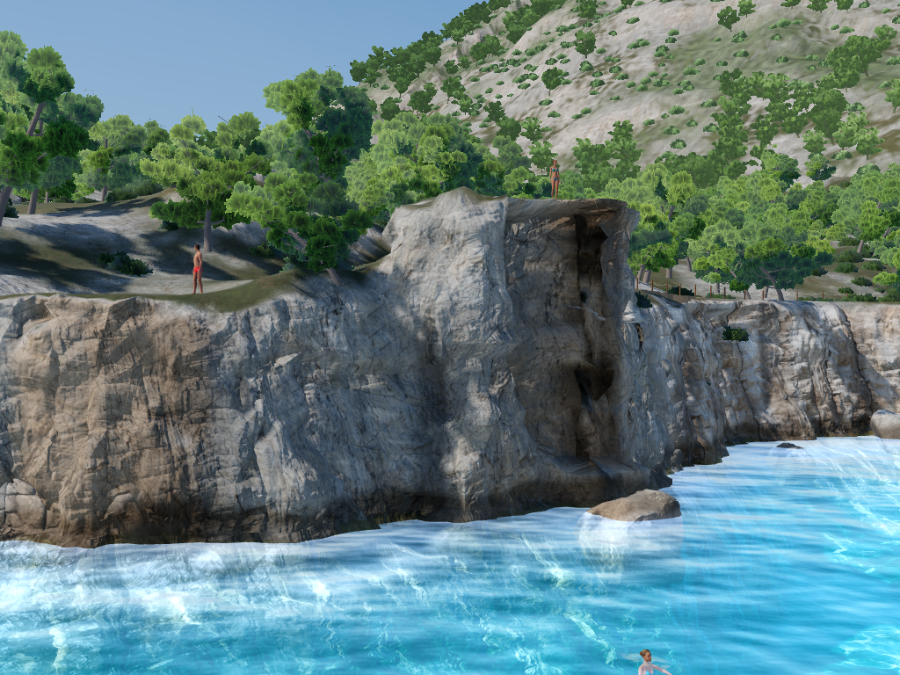 | 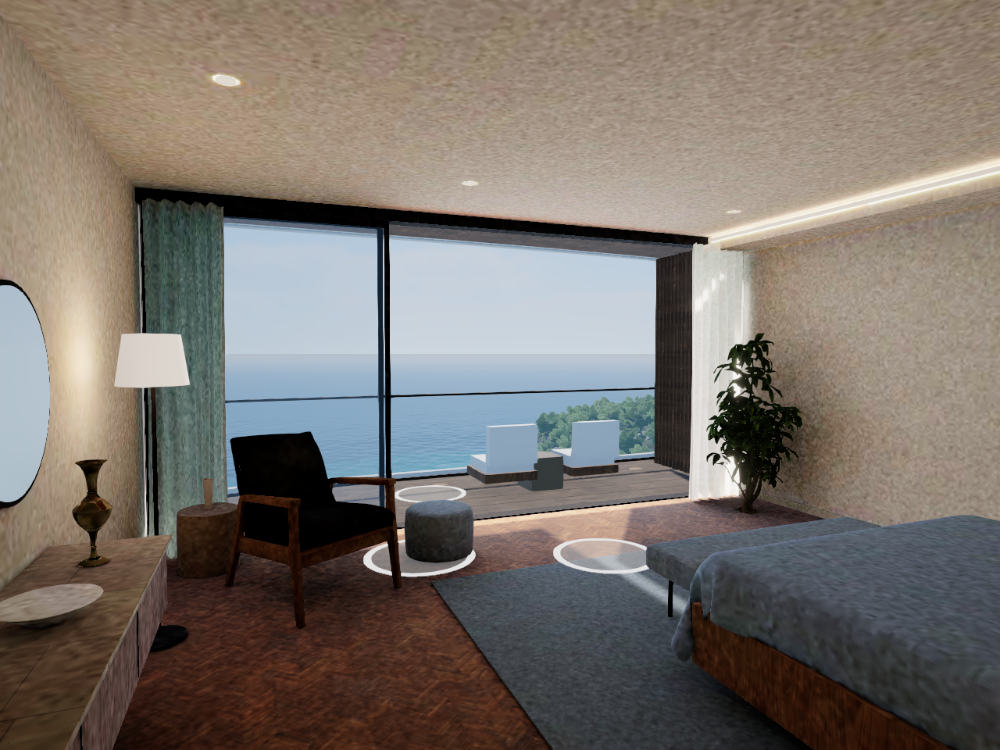 |
| **Bedroom** | **Facade** |
| 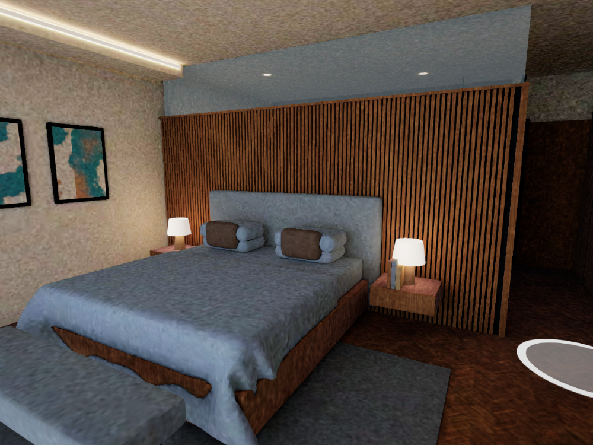 | 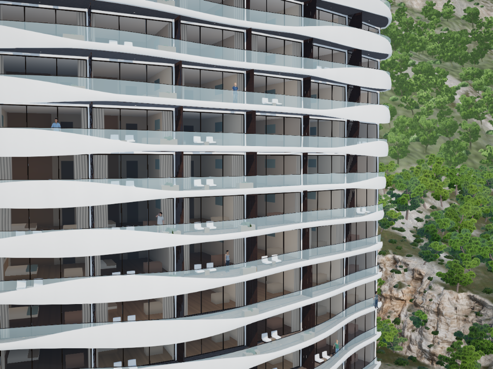 |
| **Blender render** | **Blender render** |
| 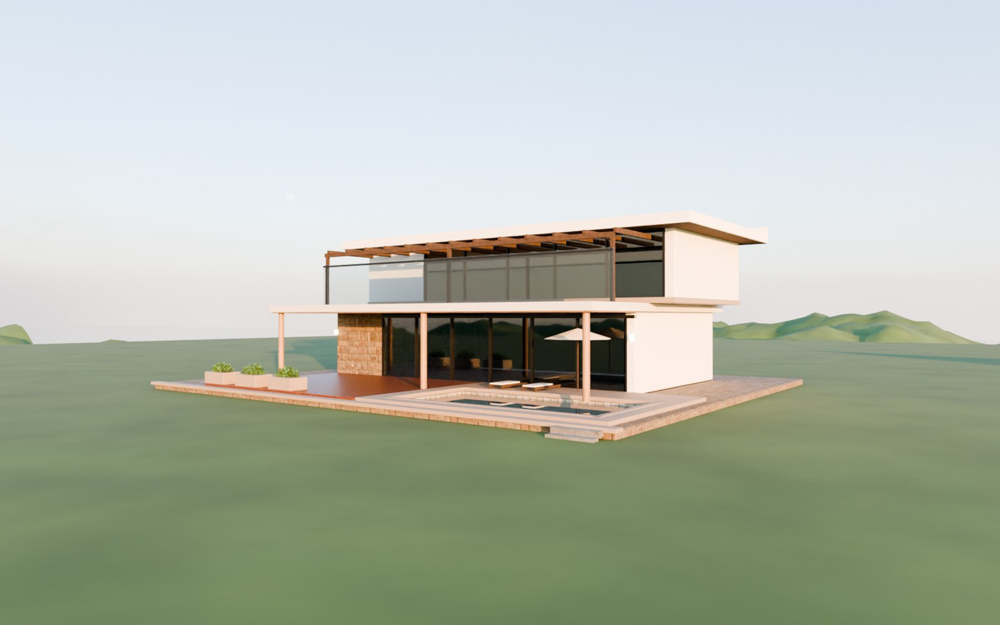 | 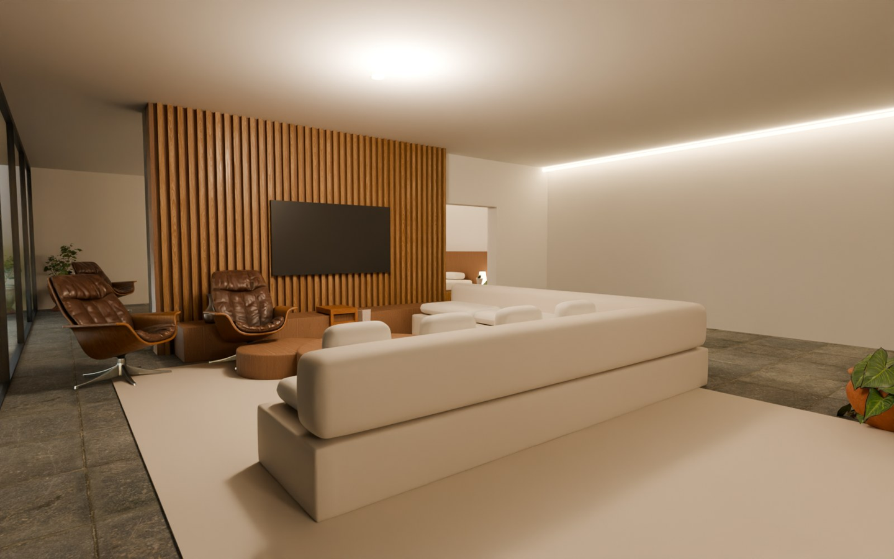 |

The first image was captured from the running application. The others are captures and Blender renders produced by the project itself.

## Main dependencies

`@react-three/drei`, `@react-three/fiber`, `@react-three/postprocessing`, `leaflet`, `postprocessing`, `react`, `react-dom`, `react-leaflet`, `three`, `zustand`

## Structure

```text
blender/                          28 files
docs/                             69 files
public/                           214 files
references/                       6 files
scripts/                          7 files
src/                              4 files
src/data/                         13 files
src/lib/                          4 files
src/scene/                        43 files
src/ui/                           7 files
```

## Commands

```bash
npm install
npm run dev
npm run build
```

## Usage

Published for portfolio and presentation purposes. No license is granted for reuse.
